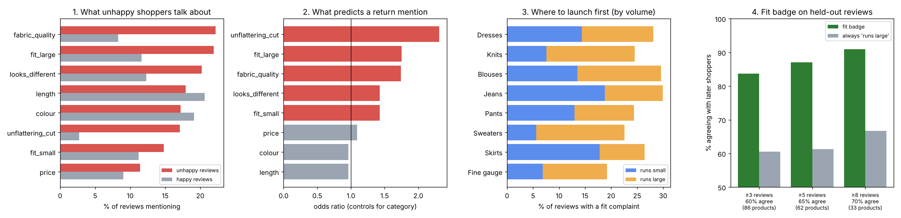
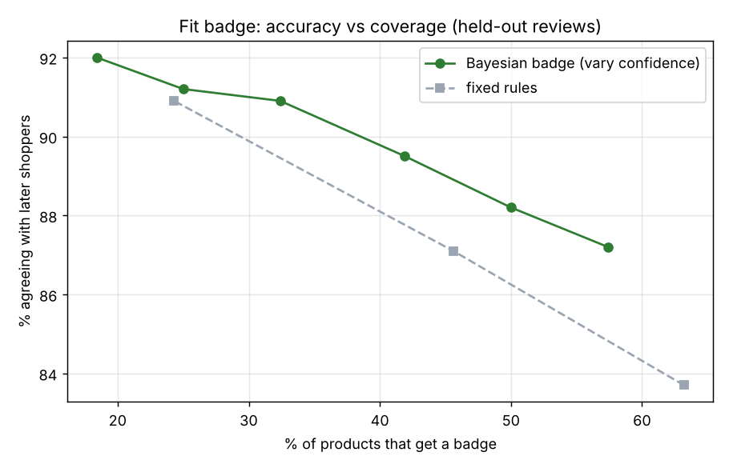

# Fit & Returns Lab: Finding Why Fashion Shoppers Return Things, and Testing a Fix

[](https://github.com/f20220970-debug/myntra-fit-returns-lab/actions/workflows/tests.yml)

**[Live demo](https://f20220970-debug.github.io/myntra-fit-returns-lab/)**: Try the badge explorer and the product-page prototype.

## In 30 seconds
- When a review mentions a return, 36% of the time it also mentions fit.
- A review-based fit badge agreed with later shoppers 87% of the time on held-out reviews, vs 61% for a naive rule.
- A model check found a driver my rules missed, an unflattering cut, which became the strongest return predictor (odds ratio 2.3).


Built exclusively for **Myntra's PS-II Product Management internship**. It treats size-and-fit returns as a
product problem: find what drives bad experiences and returns, decide which categories to fix first,
design a small feature (a review-based **fit badge** on the product page), **test whether it would be right
before building it**, size the business case, and plan the A/B test and rollout.

> **Real data, used as a proxy.** Myntra's review and returns data is private, so this uses 23,486 real
> customer reviews from a women's fashion e-commerce site (public "Women's E-Commerce Clothing Reviews"
> dataset; 1,179 products, 20 categories). The method transfers; Myntra's own numbers will differ.



## Questions and answers
| Question | Answer from the data |
| --- | --- |
| How common is the problem? | 24% of reviews are unhappy (rating ≤ 3 or not recommended); 10% mention a return |
| What do unhappy shoppers talk about? | Fabric quality (22% of unhappy vs 8% of happy), runs large (22% vs 12%), looks different from the photo (20% vs 12%), and an **unflattering cut** (17% vs 3%, a **6.3× gap**, found by the model check below) |
| What predicts a return mention, controlling for category? | **Unflattering cut (odds ratio 2.31)**, runs large (1.75), fabric (1.74), runs small (1.43), looks different (1.43). Colour, length and price do not (≈1.0) |
| How much of the return talk is about fit? | **36%** of reviews that mention a return also mention fit |
| Where to launch first? | **Dresses** (1,602 fit-complaint reviews), **Knits** (skew large: 17% vs 8% small), **Blouses**. Jeans and Skirts skew small, so the badge must say which way |
| Would a fit badge be right? | Yes, with a minimum-evidence rule. Built from 70% of each product's reviews and checked against the other 30%, it agreed with later shoppers **87% of the time vs 61%** for "always say runs large" (62 products; bootstrap 95% CI 77–95% vs 50–73%; gain +26 pp, CI 11–40) |
| Is it worth it? | Per 1M fashion orders a month: about **3,900 fit returns avoided** and **₹1.7 Cr a year** saved in the base case (range ₹0.2–12.5 Cr). A small, cheap lever; the A/B test measures the two assumptions that drive it |

## The fit badge rule, and the trade-off it makes
| Rule | Products badged | Badge agrees with later shoppers | Baseline | Share of fit reviews covered |
| --- | --- | --- | --- | --- |
| ≥3 fit reviews, 60% agree | 86 | 83.7% | 60.5% | 53% |
| **≥5 fit reviews, 65% agree (v1)** | **62** | **87.1%** | 61.3% | 43% |
| ≥8 fit reviews, 70% agree | 33 | 90.9% | 66.7% | 27% |

A stricter rule is more accurate but covers fewer products. A wrong badge ("runs small" when it runs large)
causes the exact return it should prevent, so accuracy matters more than coverage at launch. Products below
the bar show nothing, and coverage grows as reviews arrive.

**Prototype:** [`docs/prototype.html`](docs/prototype.html) shows the badge on 5 real products with real
review lines (open it in a browser).

## Going deeper (`src/deep.py`, `src/business_case.py`)

### 1. A Bayesian badge covers more products at the same accuracy
Fixed thresholds treat "4 of 5" and "40 of 50" the same. A **Beta-Binomial model** with a prior fitted
across all products (empirical Bayes, prior mean 46% "small") gives each product a probability that it
really runs small, and shows a badge only when that probability is high enough.



| Rule (same held-out test) | Products badged | Agreement |
| --- | --- | --- |
| Fixed: ≥5 reviews, 65% agree | 62 | 87.1% |
| **Bayesian: P ≥ 0.80** | **78 (+26%)** | **87.2%** |
| Bayesian: P ≥ 0.85 | 68 | 88.2% |
| Bayesian: P ≥ 0.95 | 44 | 90.9% |

Same accuracy, 26% more products with a badge, and one confidence dial instead of two thresholds. Products
with 1–4 fit reviews never get one (correct: too little evidence); with 5–9 reviews, badges agreed 93% of
the time. Caveat: 135 test products, so the gap between rules is within noise; the case for Bayes is
mainly that it's simpler to tune and handles small counts properly.

### 2. What my phrase rules missed (a model checking my taxonomy)
A TF-IDF + logistic regression model predicts an unhappy review with **AUC 0.94**; my 8 readable rules alone
reach 0.69. The rules are for explaining *why*, not for predicting, but the model's strongest words show
gaps. Among them: *unflattering*, *frumpy*, *shapeless*, *weird*, *swimming (in it)*. I added an
**"unflattering cut"** theme and "swimming in" to "runs large", reran everything, and the new theme became
the **strongest return predictor** (odds ratio 2.31).

**Product implication:** a fit badge cannot fix a silhouette that doesn't suit someone. That needs a
second feature: **photos of the item on different body types plus the model's size and height** on the
product page (also addresses "looks different from the photo"). PRD section 9.

### 3. Business case (`fit_badge_business_case.xlsx`, live formulas)
| Input | Base | Source |
| --- | --- | --- |
| Fashion return rate | 30% | Return Prime data (Apparel Resources, Jul 2024): 30–35% for clothing and shoes |
| Share of returns due to size/fit | 40% | Return Prime ~40%; Myntra's co-founder has said nearly 50% (Business Insider) |
| Orders on badged products | 43% | this repo |
| Shoppers who see and act on it | 25% | **assumption**, measured by the A/B test |
| Fit returns avoided when they act | 30% | **assumption**, measured by the A/B test |
| Cost to process a return | 30% of item value | Shipmozo guide: 20–65% |

Result per 1M orders a month: **3,870 fit returns avoided (1.3% of all returns), ₹1.7 Cr a year** in the base
case. Honest read: it's a modest lever, which is why it should ship as a cheap experiment, and why the
second feature (fit photos) matters.

## How the analysis works
1. **Friction taxonomy** (`src/analysis.py`): readable phrase rules for 8 themes plus return mentions, with a
   negation guard ("not too tight", "isn't boxy") and word boundaries ("tent" ≠ "content").
2. **Drivers:** share of unhappy vs happy reviews mentioning each theme.
3. **Return model:** logistic regression of "mentions a return" on the themes plus category dummies.
4. **Category priority:** fit-complaint volume and direction per category.
5. **Fit badge evaluation:** per-product 70/30 split; badge from the first part, judged by the majority of
   the held-out fit reviews; compared with a naive baseline; bootstrap CIs.
6. **A/B sizing:** two-proportion test, 80% power, 5% significance.

### Checking the tagger (precision audit)
I read 15 random matches per theme:

| Theme | Correct | Typical miss |
| --- | --- | --- |
| Runs small | 13/15 (87%) | "wonderfully snug" (positive) |
| Runs large | 11/15 (73%) | "runs true to size, you could size down"; mixed sizes |
| Unflattering cut | 12/15 (80%) | "doesn't make you look shapeless"; "worried it would be unflattering" |
| Fabric quality | 10/15 (67%) | "thin" describing a person; "little pilling, a plus" |

Fixes that came from this audit: word boundaries, a negation guard, and narrowing "huge" (it matched "huge
fan"). The fabric finding is **directional**: the 2.7× gap survives this noise, the exact percentage doesn't.

## Product proposal
[`docs/PRD.md`](docs/PRD.md): problem, users, the badge, KPI tree, A/B design, guardrails, rollout plan,
release note and the follow-up feature.

## Run it
```bash
pip install -r requirements.txt
python src/analysis.py          # -> results/*.csv, results/summary.json
python src/deep.py              # Bayesian badge, bootstrap CIs, TF-IDF taxonomy check
python src/business_case.py     # -> fit_badge_business_case.xlsx
python src/plot.py              # -> docs/results.png
cd src && python prototype.py   # -> docs/prototype.html
pytest -q                       # 7 tests
```

## Limitations
- Reviews are not returns. "Mentions a return" is a proxy; with Myntra's data the target would be the actual
  return reason code.
- One retailer, women's clothing, mostly US sizing. Indian sizing varies more by brand, which likely makes
  fit badges more useful, but that needs checking.
- The badge evaluation measures agreement with later reviewers, not the effect on returns. Only the A/B test
  can show that.

Built by Pavitra Seth (BITS Pilani) as preparation for Myntra's PS-II. Not affiliated with Myntra.
